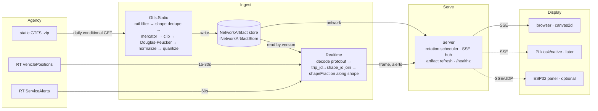

# MetroDisplay — Design

**Date:** 2026-09-22
**Status:** Approved. Build order revised 2026-09-24 into small vertical slices (§14).

---

## 1. Overview

MetroDisplay is an always-on display that renders a rail transit system as a minimal
wireframe map with live vehicle positions drawn from GTFS-RT feeds. It rotates between
cities on a fixed dwell (~5 minutes each).

It should read as art from across a room and reward close inspection with real data.

**v1 target:** a web page. **Endgame:** a small dedicated screen driven by a Raspberry Pi
or similar. The architecture treats the browser as one renderer among several rather than
as the product, so the second renderer is a transcription rather than a redesign.

### Goals

- Rail-focused: metro, light rail, commuter rail, rail hybrids. No buses.
- Geographically truthful map at uniform scale, wireframe aesthetic.
- Water and coastline drawn behind the rail network, so the map reads as a place and not
  only as a diagram.
- Live vehicle positions with continuous motion, not periodic twitching.
- Adding a city is a config file, not code.
- The display can be dumb enough to reimplement on constrained hardware.

### Non-goals (v1)

- Interactivity. Nothing is clickable; there is no input device.
- Trip planning, arrival predictions, or per-station detail.
- Bus networks, which are too dense for this treatment and would swamp the map.
- Historical data, playback, or storage of feed history.

---

## 2. Decisions

| Axis | Decision |
|---|---|
| Map geometry | Simplified geographic. True bearings, Douglas–Peucker simplification. Never schematic/octolinear. |
| Scale | Uniform. One meters-per-unit for the whole map; no compression or warping of any branch. |
| Extent | Real-distance radius from a configured city core point. |
| Overflow | Hard clip at the extent edge, with a `TO <TERMINUS>` label so the cut reads as deliberate. |
| Screen layout | Full-width map with a dense bottom rail (counts, alert ticker, rotation progress). |
| Vehicle motion | Tween along the track polyline between polls. No dead reckoning in v1. |
| RT feeds | VehiclePositions + ServiceAlerts. No TripUpdates in v1. |
| Topology | Hosted backend, thin displays. One feed poll regardless of display count. |
| Scene contract | Normalized unit-space coordinates, server-side projection. Split into `network` and `frame` messages. |
| Transport | Server-Sent Events. `POST /control` reserved for future input. |
| Transition | Crossfade, ~700 ms. |
| Backend | .NET |
| Renderer | TypeScript, canvas2d |
| Static GTFS | Separate project building versioned artifacts, run in-process; daily conditional refresh. |
| Background | Filled water and coastline behind the network, from OpenStreetMap through Overpass, fetched once per city and kept (slice 2, §14). |

### Rationale on the contested ones

**Why not octolinear.** A Beck-style diagram is the most recognisable transit map form, but
good octolinear layout is an NP-hard optimisation that is hand-drawn in practice. It also
breaks the lat/lon → screen identity, forcing every vehicle through a snap-to-segment step
against hand-authored geometry. That converts "add a city = config file" into "add a city =
an afternoon of drawing". Deferred, not rejected: the contract carries projected
coordinates, so a per-city hand-drawn override could be added later for a favourite city
without touching the pipeline.

**Why clip rather than compress.** Long outlying branches (BART to Antioch, WMATA to
Ashburn) otherwise squash the dense core into a fraction of the screen. Compressing them
with a log or radial warp would preserve the endpoints but destroy the property that makes
the map worth looking at: that 2 km downtown and 2 km in the suburbs are the same length on
screen. Clipping keeps scale honest and loses only geometry that was unreadable anyway.

**Why tween and not dead reckoning.** Dead reckoning shows where a train *is* rather than
where it *was*, which is more truthful in principle. In practice `vehicle.position.speed`
and `.bearing` are optional in the GTFS-RT spec and frequently absent, so it would silently
degrade to snapping on some cities, and visible snap-backs when a prediction is wrong look
worse than a consistent lag. Both options share all the hard machinery (projection onto a
distance-along-shape), so adding dead reckoning later is cheap.

**Why SSE and not WebSocket.** No data flows client→server after the handshake; displays
are pure receivers, so WebSocket's duplex capability is unused. SSE is a plain HTTP GET, so
no upgrade handshake to be mangled by proxies. `EventSource` provides reconnect-with-backoff
and `Last-Event-ID` as battle-tested browser code, which matters for an unattended display
that will drop its connection constantly. The `seq` field maps onto SSE's `id:` for free.
On an ESP32 it is a long-lived GET plus line parsing, with no WebSocket library. The one
thing WebSocket would buy is binary frames; at ~2 KB per frame, base64's 33% overhead is
not a constraint. Future control input belongs on a stateless `POST /control`, not folded
into the render stream.

---

## 3. Architecture



### Projects

```
MetroDisplay.Contracts      Scene DTOs + city config schema. Zero dependencies.
MetroDisplay.Spatial        Projection, ground distance, bounds, normalization. Zero dependencies.
MetroDisplay.Gtfs.Static    Library. Builds versioned NetworkArtifacts.
MetroDisplay.Realtime       GTFS-RT polling, protobuf decode, RT→static join.
MetroDisplay.Osm            OpenStreetMap layers: fetch-once Overpass cache, water polygons.
MetroDisplay.Server         ASP.NET Core. Rotation, SSE, artifact refresh, health.
web/                        Vite + TypeScript renderer (canvas2d).
cities/                     One JSON per city.
docs/design/mockups/        Design mockups from the brainstorming session.
```

The Server exists from slice 1 (§14): it builds the scene at startup and serves it to the
renderer, so the final topology is in place before any feature needs it. A standalone
artifact-building CLI is optional. It only earns a place if the in-process build ever
needs to run as a scheduled job (slice 14).

### Boundaries

- `Contracts` has no dependencies. TypeScript types are generated from it, so a renamed
  field breaks the renderer build rather than silently rendering nothing at runtime.
- `Gtfs.Static` is the only component that parses GTFS CSVs. `Realtime` is the only
  component that decodes protobuf. Neither calls the other; they meet only through a
  `NetworkArtifact` referenced by version id.
- Fetching is injected at the edge of both ingest components. Everything downstream of it —
  static pipeline stages 2–8, and the whole realtime join — is a pure function over bytes,
  so those tests run against committed fixtures with no network and no API keys.
- `Osm` is the only component that reads OpenStreetMap data. It hands the Server layers
  already normalized to the rail network's frame, and never sees GTFS.
- `INetworkArtifactStore` is the extraction seam: disk today, blob storage later, with
  no caller changes. A CLI over the same library can run as a scheduled container if the
  in-process job ever becomes inadequate.

### Why canvas2d and not SVG

A few hundred tweened vehicles at 60 fps is where SVG's per-node DOM cost begins to bite.
More importantly, canvas is immediate-mode — the same five drawing operations a Pi
framebuffer renderer would implement. Writing the browser renderer in canvas makes the
native port a transcription.

---

## 4. Coordinate system

One transform, applied server-side, once per city.

1. **Project.** lat/lon → Web Mercator (EPSG:3857). Rail systems span under 100 km, so
   Mercator's area distortion is irrelevant; what matters is that it is conformal, so the
   network keeps its real shape.
2. **Extent.** The intersection of the content bounding box with a box of side
   `2 · coreRadiusKm` in metres, centred on the configured core point (see §5).
3. **Normalize by the longer axis.**

```
spanX       = maxX - minX
spanY       = maxY - minY
longestSpan = max(spanX, spanY)

normalizedX = (mercatorX - minX) / longestSpan
normalizedY = (maxY - mercatorY) / longestSpan   // flipped: screen convention
aspect      = spanX / spanY
```

Two properties fall out of this, both load-bearing:

- **Dividing both axes by the same `longestSpan` makes distortion impossible.** A renderer that
  ignores `aspect` entirely still draws a correctly-proportioned map; it only letterboxes
  wrong. That is a good failure mode for a renderer written later on constrained hardware.
- **Y is flipped once, server-side.** Mercator Y grows north; every screen coordinate
  system grows down. Doing it here means no renderer can get it backwards.

Coordinates land in `[0,1]` on the long axis and `[0, shorterSpan / longestSpan]` on the short one.

### Renderer fit

```ts
// The map measures min(1, aspect) by min(1, 1 / aspect) normalized units.
const scale = Math.min(
  viewportWidth  / Math.min(1, aspect),
  viewportHeight / Math.min(1, 1 / aspect),
);
const pixelX = originX + normalizedX * scale;
const pixelY = originY + normalizedY * scale;
```

Padding is the renderer's responsibility, not the server's — the renderer insets for its own
chrome (the bottom rail). This keeps the scene free of any viewport term, which is what
allows one scene to be computed once and broadcast to every connected display.

### Precision

Coordinates are quantized to 4 decimal places. At a 60 km extent on a 1920 px display one
pixel is ≈31 m, and `1e-4` of extent is ≈6 m — about a fifth of a pixel. Visually lossless,
and roughly halves JSON size. Polylines ship as flat `[x0,y0,x1,y1,…]` arrays rather than
`[{x,y}]`, which halves size again and maps directly onto a `Float32Array` or a future
binary frame without changing the contract's shape.

---

## 5. Extent and clipping

The extent is set by real distance, never by fitting to whatever extremes the data contains:

```
config: { core: [42.3555, -71.0605], coreRadiusKm: 22 }
```

This makes scale statable in words — "Boston shows 44 km across" — and legible when it
looks wrong. A percentile-of-points extent was considered and rejected: it is weighted by
shape point *density*, so a densely-sampled branch drags the extent outward while a sparse
one gets cut early, which is unpredictable per city.

**Aspect.** The extent is the intersection of the content bounding box with a square of side
`2 · coreRadiusKm` centred on the core point. Everything within `coreRadiusKm` of the core is
therefore always visible, and a system that does not fill the square is not padded out to it.
`aspect` in §4 is the aspect of that intersection.

**Overflow handling.** Polylines are hard-clipped at the extent boundary, mid-segment. At the
clip point, `Gtfs.Static` emits an `edgeLabel` carrying the terminus name (from the trip
headsign, falling back to the shape's last stop name), its position, and the segment angle.
The renderer only draws text at a point; it never learns what clipping is.

**Clip before simplify.** Douglas–Peucker runs after clipping, so its tolerance budget is
not spent on geometry that runs 40 km outside the extent.

**Vehicles outside the extent** are dropped from the map but retained in the per-line counts, so the
counts reflect true system-wide service. The bottom rail labels this explicitly (e.g.
`RED 41 ⌁SYS`) so the mismatch with visible dots reads as intentional. The contract also
carries an `onMap` count so the renderer can show the delta later without a contract change.

---

## 6. Static GTFS pipeline

`MetroDisplay.Gtfs.Static` is a library. Input: a city config. Output: an immutable
`NetworkArtifact` — the `network` message payload plus a manifest recording source ETag,
`feed_end_date`, build timestamp, and version id.

It is a pure function of (zip bytes, city config), so it is testable against a committed
fixture zip with no network access.

### Stages

1. **Fetch** — conditional GET with `If-None-Match` / `If-Modified-Since`. A 304 costs
   nothing and does no work.
2. **Filter to rail** — `route_type` in {0 tram/light rail, 1 subway/metro, 2 rail,
   5 cable tram, 7 funicular, 12 monorail}, minus any `routeFilter.exclude`. Only
   `routes.txt`, `trips.txt`, `shapes.txt`, `stops.txt` and `feed_info.txt` are read whole.
   `stop_times.txt` (the bulk of a typical zip, mostly bus data) is streamed, keeping only
   the rows of rail trips; stations need them (§14, slice 4).
3. **Deduplicate shapes** — agencies commonly emit a distinct `shape_id` per trip pattern,
   so one rail line can carry dozens of near-identical polylines. Collapsing by geometry
   hash is often a 10–50× reduction before simplification runs at all.
4. **Project** to Web Mercator.
5. **Clip** to the extent, emitting edge labels.
6. **Simplify** with Douglas–Peucker at `simplify.toleranceM`.
7. **Normalize** and **quantize** per §4.
8. **Validate** — reject the artifact if it contains zero rail shapes (see §12).

### Refresh

Backend runs the pipeline at boot and re-checks daily with a conditional GET. Rail static
feeds change roughly monthly, and agencies usually publish a replacement days-to-weeks
before the old one expires. A new artifact is only built when the ETag actually moves.

Staleness does not primarily damage the map — geometry barely changes, since new stations
open on a scale of years. It damages the **join**: RT supplies `trip_id` and `route_id`,
resolved against static to pick a shape. A stale artifact means unmatched trips, so vehicles
are silently dropped exactly during a service change, which is when you would most want to
see them.

---

## 7. Realtime pipeline

`MetroDisplay.Realtime` is the only component that speaks protobuf. Per city it polls
VehiclePositions on the agency's cadence and ServiceAlerts more slowly, decodes, and
resolves each vehicle against the current artifact.

### Vehicle projection

For each `VehiclePosition` entity:

1. Resolve `trip.trip_id` → `shape_id` via the artifact's trip index. Fall back to
   `trip.route_id` → the route's primary shape when `trip_id` is absent or unmatched.
   A route's primary shape is the one used by the greatest number of its trips, resolved
   once at artifact build time.
2. Project the vehicle's lat/lon to the nearest point **on that shape only** — never
   globally. Global nearest-point matching puts trains on the wrong line wherever lines
   share trackage (the MBTA Green Line core, BART's Market Street tunnel).
3. Emit `shapeFraction`, the fraction along that shape's polyline.

`shapeFraction` is the single scalar that makes everything downstream cheap: one float per vehicle,
and the renderer never sees a latitude. A design that shipped lat/lon per vehicle would
force every client to solve nearest-point-on-polyline — an O(segments) search per vehicle
per frame — just to draw a dot on the track.

### Vehicle identity

Tweening requires stable ids across frames, or trains teleport. Identity is
`vehicle.vehicle.id` where present and stable, falling back to `trip_id`.

---

## 8. Wire contract

Transport is SSE at `GET /stream`. Each message is one SSE event whose `data:` is a JSON
object with a `type` discriminator. `frame` messages set SSE `id:` to their `seq`, so a
reconnecting display resumes with `Last-Event-ID`.

The C# records in `MetroDisplay.Contracts` map one-to-one onto the discriminators:

| C# type | `type` value | Cadence |
|---|---|---|
| `Hello` | `hello` | Once, on connect |
| `NetworkScene` | `network` | On connect and each city switch |
| `VehicleFrame` | `frame` | Every poll |
| `AlertSet` | `alerts` | Only when the alert set changes |

TypeScript types are generated from those records, so each discriminator string is written
in exactly one place and a rename fails the renderer build rather than the display.

### `hello` — once, on connect

```jsonc
{ "type": "hello", "protocol": 1, "serverTime": 1790098859123 }
```

The client records `serverTime - Date.now()` as a clock offset. Every later timestamp is
server-authoritative, so a Pi with no RTC and a laptop that just woke from sleep both
animate correctly.

### `network` — on connect and on every city switch

```jsonc
{
  "type": "network",
  "artifactVersion": "mbta@2026-09-01.a3f1",
  "city": { "id": "mbta", "name": "BOSTON", "agency": "MBTA", "timezone": "America/New_York" },
  "extent": { "aspect": 1.34, "coreRadiusKm": 22, "spanKm": 44 },
  "rotation": { "dwellMs": 300000, "endsAt": 1790099159123 },
  "lines": [
    { "id": "Red", "name": "RED", "color": "#DA291C",
      "shapes": [ { "id": "931_0009",
                    "points": [0.1043, 0.8812, 0.1121, 0.8790],
                    "lengthM": 28140 } ] }
  ],
  "stations": [ { "x": 0.412, "y": 0.331, "name": "Park St", "rank": 2 } ],
  "edgeLabels": [ { "x": 0.998, "y": 0.402, "text": "TO ALEWIFE", "angle": -12.4, "line": "Red" } ],
  "water": [ { "rings": [ [0.6104, 0.2011, 0.6420, 0.2135, 0.6233, 0.2502],
                          [0.6200, 0.2150, 0.6251, 0.2170, 0.6222, 0.2210] ] } ]
}
```

`water` is a list of areas. Each area's first ring is its outline and any further rings are
holes (islands), all as flat normalized `[x0, y0, …]` arrays in the same frame as the lines.
Rings are implicitly closed. The list is empty when water is unavailable (§12).

`rotation.endsAt` drives the progress bar, so there is no client-side timer drift across a
five-minute dwell. This matters on constrained hardware: a renderer that stalls 400 ms on a
slow repaint would otherwise drift every cycle, and the drift accumulates all day.

`color` comes from `routes.txt` `route_color` where present, with a per-city palette
override in config as fallback.

### `frame` — every poll

```jsonc
{
  "type": "frame", "seq": 8412, "generatedAt": 1790098859000,
  "intervalMs": 20000, "stale": false,
  "vehicles": [
    { "id": "R-5478", "line": "Red", "shape": "931_0009",
      "shapeFraction": 0.6142 }
  ],
  "counts": {
    "byLine": { "Red": 41, "Orange": 28, "Green": 63 },
    "onMap":  { "Red": 38, "Orange": 28, "Green": 63 }
  }
}
```

The renderer interpolates `shapeFraction` from the previous frame to the current one over `intervalMs` and walks the
polyline to obtain a pixel position. Vehicles must ride the track polyline, not lerp in
straight lines — raw positional tweening cuts corners through city blocks and looks
immediately wrong.

### `alerts` — only when the set changes

```jsonc
{
  "type": "alerts", "generatedAt": 1790098859000,
  "items": [
    { "id": "mbta-88421", "severity": "warning", "lines": ["Orange"],
      "text": "Shuttle buses Oak Grove–Malden" }
  ]
}
```

Sending alerts on change rather than inside every frame keeps steady-state packets small and
gives the renderer a natural trigger to restart the ticker animation rather than restarting
it three times a minute.

### Flow rules

- **Ordering interlock.** A `frame` referencing `shape` ids valid only in artifact *N* must
  never precede the `network` for *N*. The server holds frames during a switch until the new
  `network` is flushed. Violating this silently drops every train on screen.
- **Late join.** A client connecting mid-dwell immediately receives `hello`, the current
  `network`, the latest `frame`, and the current `alerts`. A display that reboots is correct
  within one round trip, not within one poll interval.
- **Cadence separation.** Geometry changes monthly, vehicles every ~20 s, cities every
  5 minutes — five orders of magnitude apart. A single combined state message would resend
  a ~200 KB network every 20 s to deliver a few hundred bytes of movement.

---

## 9. Rotation

Default dwell 5 minutes, configurable per city via `dwellMs`. Cities cycle in config order.
Rotation is server-driven, so every connected display stays in lockstep.

**Timeline of one cycle:**

| Time | Event |
|---|---|
| 0:00 | `network` for the incoming city; first `frame` already populated |
| 0:00 → 5:00 | `frame` every ~20 s; `alerts` only on change |
| 4:30 | Prefetch: load the next city's artifact, start its RT poller |
| 5:00 | `network` for the next city is pushed; the renderer crossfades (~700 ms) from the old scene to the new one on receipt |

Prefetching at dwell−30 s is what makes the switch land on a populated map rather than an
empty one that fills in over the following 20 seconds.

**Crossfade** was chosen over a hard cut (jarring in a dim room) and over a zoom-out/zoom-in
globe effect (striking, but requires both cities' geo anchors and looks wrong when systems
differ wildly in extent).

---

## 10. Renderer and layout

Full-width map with a dense monospace bottom rail. The map keeps roughly 81% of the height
and stays full width, so it still reads as the whole image from across the room.

```
┌────────────────────────────────────────────────┐
│ BOSTON                              14:32:07   │
│ MBTA · 147 ACTIVE                              │
│                                                │
│              [ network map ]                   │
│                                                │
├────────────────────────────────────────────────┤
│ ▬RED 41⌁ ▬ORG 28⌁ ▬GRN 63⌁  ⚠ alert ticker… ▰▰▱│
└────────────────────────────────────────────────┘
```

Rail contents: per-line vehicle counts, a slow alert ticker, and the rotation progress bar.
Counts carry an explicit system-wide marker (`⌁SYS`), per §5, so the gap between the number
and the visible dot count reads as intentional rather than as a bug.

Aspect ratio is the hidden constraint behind this choice. 1920×1080 is 1.78:1, but most
metro bounding boxes are nearer 1:1, so a full-bleed map already has unused width. A bottom
rail costs almost nothing real; a sidebar would eat width the map actually needs, and would
need a separate layout at 800×480.

**Sizing.** The map is sized from a measured container via `ResizeObserver`, never from
CSS-implied height. A container whose children are all absolutely positioned measures zero,
and the projection then silently fits to a 0×0 viewport.

**Renderer surface.** The complete contract is six operations: scale a unit coordinate to
pixels, draw a polyline, draw a filled circle, fill a polygon with holes (even-odd), lerp two
floats, walk a polyline to a fractional distance. No geodesy, no protobuf, no HTTP to
agencies, no GTFS awareness.

**Layers.** Water is filled first, each area on its own so overlapping areas never cut holes
in each other, in a dim blue-grey that keeps the rail dominant. Rail is drawn over it. When
water is drawn, `© OpenStreetMap contributors` appears in the corner, as ODbL requires.

---

## 11. Configuration

One JSON file per city in `cities/`. Adding a city touches no code.

```jsonc
{
  "id": "mbta",
  "name": "BOSTON",
  "agency": "MBTA",
  "timezone": "America/New_York",
  "staticFeed": { "url": "https://cdn.mbta.com/MBTA_GTFS.zip" },
  "realtime": {
    "vehiclePositions": { "url": "...", "intervalMs": 15000,
                          "headers": { "x-api-key": "${MBTA_API_KEY}" } },
    "alerts":           { "url": "...", "intervalMs": 60000 }
  },
  "routeTypes": [0, 1, 2],
  "routeFilter": { "exclude": ["CapeFlyer"] },
  "extent":   { "core": [42.3555, -71.0605], "coreRadiusKm": 22 },
  "simplify": { "toleranceM": 25 },
  "dwellMs": 300000
}
```

`${ENV_VAR}` interpolation is the only way credentials enter the system; no key is ever
committed.

`CityConfigLoader.Load` resolves placeholders from a dictionary it is handed and never reads
the process itself. The Server builds that dictionary from `IConfiguration`, which covers
.NET user-secrets locally and app settings or Key Vault references when deployed.
`LoadFromProcessEnvironment` reads process environment variables only. User-secrets never
become environment variables, so that path cannot see them. It suits a tool run from a
shell, not the Server.

v1 ships 2–3 cities, chosen for open or free-key feeds and clean rail-only shapes
(MBTA, BART, WMATA are the expected starting set). The registry design is what makes
expansion cheap later.

---

## 12. Failure behavior

| Failure | Detection | Response |
|---|---|---|
| Static fetch fails at boot | HTTP error | Serve last cached artifact. No cache → drop city from rotation, mark degraded |
| Static feed expired | `feed_end_date` in the past | Keep serving, log warning, flag in `/healthz` |
| Refresh yields zero rail shapes | Post-build assertion | **Reject** the new artifact, retain the previous one |
| RT poll 5xx / timeout | HTTP | Exponential backoff capped at 5 min; `stale: true` after 3 missed intervals |
| Protobuf decode error | Parse throws | Drop that frame only, increment metric |
| `trip_id` unmatched to a shape | Join miss | Drop vehicle, count it. Above 30% → degraded |
| Vehicle has no position | Field absent | Drop silently — normal and common |
| Slow SSE client | Send backpressure | Drop frames for that client; never block the broadcast |
| Zero vehicles for a whole dwell | Count is 0 | Still draw the map; `stale` distinguishes a dead feed from 3 a.m. |
| Water fetch fails on first start | HTTP error, timeout, or an Overpass `remark` | Start without water; cache nothing, so the next start retries |
| Cached water unreadable | Parse throws | Start without water; the warning names the file to delete |
| Coastline does not close | A gap in OSM's coastline, or data that stops short of the map edge | Start without water; never a flooded map |

Three of these carry design weight:

- **Rejecting a zero-shape artifact.** An agency publishing a broken feed must not be able
  to blank the wall. This generalises: any refresh that replaces working state validates
  before swapping, because the failure arrives on the agency's schedule, typically overnight.
- **`stale` rather than blanking.** A frozen map reads as "feed down"; an empty one reads as
  "app broken". Without the flag, a dead feed and a genuinely empty system at 2 a.m. are
  indistinguishable on screen, and they should look different.
- **Unmatched-trip rate as the health signal.** It measures whether the join still works,
  which is the thing that actually matters, rather than a `feed_end_date` an agency may not
  maintain.

`/healthz` exposes, per city: feed age, unmatched-trip rate, artifact version, artifact age,
and `feed_end_date`.

---

## 13. Testing

Test-driven throughout. Fetching is injected at the edge of both ingest components, so
everything downstream of it is a pure function over bytes. Those tests run against committed
fixtures, and CI needs no network and no API keys. The fetch layer itself is tested
separately against a stub HTTP handler, covering conditional-GET behavior and backoff.

**`Gtfs.Static`** — fixtures are synthetic GTFS zips built in memory by test code
(`GtfsFixtureBuilder`). A test then reads as "three routes, one of which is a bus" instead of
"trust this binary", and no agency data is committed. Real feeds are checked by hand at the
end of each slice. Golden-snapshot the artifact JSON. Properties asserted directly:

- every emitted point lies within `[0,1]`
- aspect is preserved under scaling (uniform scale, no distortion)
- Douglas–Peucker deviation never exceeds the configured tolerance
- Y is flipped (a known-north point maps to a smaller `normalizedY`)
- an edge label is emitted for every clipped shape
- shape deduplication collapses known-duplicate fixtures

**`Osm`** — fixtures are small hand-built geometries and Overpass JSON snippets. Coastline
closing is tested on a unit map against straight coasts, islands, peninsulas, reversed land
sides and no coastline at all, asserted by polygon area and ring count. The Overpass cache is
tested against a stub handler, including a `remark` response that must not be cached.

**`Realtime`** — fixture is a captured protobuf blob. Tests cover the `trip_id → shape_id`
join, that `shapeFraction` advances monotonically along a shape for a vehicle moving in one direction,
that nearest-point matching is constrained to the vehicle's own shape, and that unmatched
trips are counted rather than swallowed.

**`Server`** — integration tests over a real SSE connection: a late join returns
`hello` + `network` + `frame` + `alerts`; frames referencing artifact *N* never precede the
`network` for *N*; `Last-Event-ID` resumption works. Until SSE arrives, the HTTP endpoints
are tested in memory through `WebApplicationFactory`.

**Renderer** — Vitest unit tests for the contain-fit math and the polyline walk. Both are pure,
and both are what a future native renderer reimplements, so the tests port with them.

---

## 14. Build order

Small vertical slices. Each slice is one plan of three to seven tasks and ends with
something visible on screen or checkable by hand. Only the current slice has a detailed
plan. The next is written once the current one lands, so it can use what the last one
taught.

Pixels come first. Projection, clipping, and simplification bugs are nearly invisible in
tests but obvious the instant the map is on screen, so slice 1 draws a map before any
refinement of the geometry exists.

| # | Slice | Done when |
|---|---|---|
| — | Scaffold, contracts, city config | Done. `NetworkScene` wire shape pinned by a test; strict `CityConfigLoader` |
| 1 | Lines on screen | Boston's rail lines in route colours, fit to the window. The Server builds the scene at startup and serves `GET /api/network`; the renderer draws polylines |
| 2 | Water and coastline | Boston's harbour, rivers and lakes filled behind the lines; OSM attribution shown |
| 3 | True-scale extent and clip | Map framed on core ± `coreRadiusKm`; with commuter rail enabled, lines are visibly clipped |
| 4 | Stations | A marker at every station; interchanges and termini named where the name fits |
| 5 | Vehicle positions | `Realtime` decodes VehiclePositions and joins them to shapes; `shapeFraction`s checkable at `GET /api/frame` |
| 6 | Live dots over SSE | `/stream` delivers `hello`, `network`, `frame`; dots drawn, snapping each poll |
| 7 | Edge labels | `TO <TERMINUS>` where each clipped line leaves the map |
| 8 | Place names | Notable cities and towns labelled from OSM `place` nodes, ranked by type and population, clear of the lines |
| 9 | Lean geometry | Shape dedupe and Douglas–Peucker for rail. The map looks the same; the payload shrinks |
| 10 | Tweening | Dots glide along the track between polls |
| 11 | Bottom rail | City name, clock, per-line counts |
| 12 | Alerts ticker | ServiceAlerts polled; ticker in the rail |
| 13 | Second city and rotation | BART added; dwell, progress, crossfade, prefetch |
| 14 | Unattended hardening | Conditional-GET daily refresh, artifact store and versioning, backoff, `stale`, `/healthz`, the §12 failure table |
| 15 | Generated contract types | TypeScript types generated from `Contracts`; renaming a C# field fails `tsc` |
| 16 | Minor clean-up | The small findings set aside by each slice's review, listed below, fixed or struck off |

### What slice 1 leaves out, and why

- **Extent, clipping, edge labels, stations.** Each gets its own slice, so its effect is
  visible in isolation. Slice 1 normalizes against the network's own bounding box. §4's
  transform is unchanged; its extent step simply arrives in slice 3.
- **Dedupe and simplification.** On 2026-09-24, MBTA subway and light rail measured 65
  shapes, 17,579 points, about 250 KB of JSON. Raw geometry is fine at that size. A large
  system such as New York or London could be 10–50× that, so slice 9 lands before any
  large city does.
- **Artifact store, manifest, conditional GET.** Versioning matters only once a network is
  replaced while running (§8's ordering interlock). A scene built once at startup is never
  replaced. Until slice 14, `artifactVersion` is `<cityId>@` plus the first 8 hex digits of
  the zip's SHA-256. It derives from content, so the same zip always yields the same version.
- **Failure handling.** Slices 1–13 fail fast at startup with a message naming the cause.
  §12's degrade-and-keep-serving behaviour protects an unattended display and arrives with
  slice 14. Water is the one exception from slice 2 on: it is decoration from a volunteer-run
  API, so its failures degrade to a map without water instead of stopping startup.
- **Trip index.** It arrives with its only consumer, slice 5, built in memory alongside the
  scene.

### Water and coastline (slice 2)

Moved ahead of the generated types and the extent on 2026-09-28. Its design settled:

- **Source.** OpenStreetMap through the Overpass API, queried for the square of core ±
  `coreRadiusKm`. The raw response is cached per city, layer and query
  (`.cache/osm/<cityId>-water-<queryHash>.json`) on the first start and kept for good:
  coastlines change on a scale of years, so unlike the GTFS feed it is never refreshed. Delete
  the file to fetch again. The query is part of the name because a changed core or radius asks
  for a different square, and the answer for the old square would leave the coastline short of
  the new map's edge; such a change fetches once more and leaves the old file behind. Adding a
  city stays a config file.
- **Fill.** Water is filled. Coastline ways are overlaid on the map edge and closed along it
  into sea polygons (OSM keeps land on the left). Lakes and rivers come from
  `natural=water` and `waterway=riverbank` ways and multipolygon relations, with islands as
  holes. Geometry uses NetTopologySuite; the coastline closing is ours. A coastline that does
  not close against the map edge cannot be told into sea and land, so it is refused and the
  map starts without water instead of flooded.
- **Frame.** Water is clipped to the square of core ± `coreRadiusKm` and normalized with the
  rail's extent so both layers line up. Water coordinates therefore fall outside `[0, 1]`
  wherever the square is larger than the extent. That is intended: water is a backdrop that
  runs on past the rail's frame, and the screen edge does the cutting. Clipping water to the
  rail's own frame was tried first and ended the harbour in a hard edge at the easternmost
  station.
- **Noise and size.** Areas under 2 ha of ground are dropped, and outlines are simplified with
  a topology-preserving simplifier at 15 m of ground distance, converted to plane units.
- **Licence.** ODbL: `© OpenStreetMap contributors` is shown whenever water is drawn.
- **Place names (slice 8)** reuse the same cache and reader with a second layer file, so
  adding them never refetches water.

### True-scale extent and clip (slice 3)

Implements §4's extent step and §5's clipping. Its design settled on 2026-10-11:

- **Extent.** The rail's bounding box intersected with the core square, exactly as §5 says.
  The core square is the same box water is fetched and clipped for, built by the same code, so
  the two layers cannot disagree about it. A system smaller than its square, such as Boston's
  subway, is framed on its own bounds and is not padded out.
- **The rail fills the frame; water does not stop at it.** Framing everything on the whole core
  square was considered. It would state one scale for every city, but a small system would sit
  small in the middle of the screen. Cutting water to the rail's frame was already rejected in
  slice 2. So the extent frames the rail, and water keeps the core square.
- **Clip.** Each shape is cut at the extent's edges, mid-segment. A shape that leaves and
  returns becomes several runs; runs after the first carry `#1`, `#2` on the shape id. A shape
  wholly outside is dropped, and a route left with nothing is left off the map. `lengthM` is
  the ground length of the run that is drawn.
- **No rail in the square** stops startup with a message naming the core point and radius. It
  means the config points at the wrong place.
- **Where it lives.** `GeoBox` moves from `Osm` to `Spatial`, since `Gtfs.Static` needs the core
  square and must not depend on `Osm`. The rectangle intersection and the polyline clipper are
  pure geometry in `Spatial`. `Gtfs.Static` computes the extent, clips, then normalizes. `Osm`,
  the Server, the renderer and the wire contract do not change.
- **Known limit.** When a network fills its whole square, as Boston's does with commuter rail,
  the extent and the water box coincide. Water then has nothing to run on into, and a screen
  wider than the map shows empty bands beside it. Fetching water for a wider box is a separate
  decision, taken once that case is on screen.
- **Decided 2026-10-29, built later.** That case is now on screen: at a small radius the map
  is a square in the middle of a wide screen. Instead, the map should be `2 · coreRadiusKm`
  tall and as wide as each display allows, so a 16:9 screen and a browser window of another
  shape each show as much of the city as fits their own width, at the same scale. Rail and
  water then have to reach past the square's sides, and since only the renderer knows a
  window's shape, the final framing has to happen there. A window taller than it is wide is
  still to be decided. This waits until the display works end to end.
- **Left for later.** Edge labels at the cut points are slice 7. Where each run starts along
  its original shape, which vehicle positions need, is added in slice 5 with its consumer.

Commuter rail stays out of `cities/mbta.json`. It is switched on by hand to see the clip.

### Stations (slice 4)

Stations are there so a viewer can place a train: "that one is near Park Street". They carry
no detail of their own (§1, non-goals). Design settled on 2026-10-13:

- **Look.** A marker at every station. A name only at interchanges and termini, so the map is
  not covered in text.
- **Which stops are stations.** `stops.txt` is read, and `stop_times.txt` is streamed keeping
  only the rows of trips on the selected rail routes. A station is the stop's
  `parent_station`, or the stop itself where it has none, so platforms merge into one marker.
  Position and name are the station's own `stop_lat`, `stop_lon` and `stop_name`. Markers are
  not snapped to the track: at city scale a station's centre lies within a pixel or two of its
  line.
- **Stations at the edge.** The extent's edge is set by the track, and a station's own position
  is the middle of the station, which at the end of a line lies a little past the last point of
  track. Boston's Riverside is 26 m outside the frame its own line sets. So a station within
  100 m of ground beyond the edge is drawn on the edge. One farther out is dropped: its line
  was cut before reaching it.
- **`rank`.**

  | Rank | Meaning | Rule |
  |---|---|---|
  | 3 | Interchange | Served by routes of two or more different colours |
  | 2 | Terminus | Some trip on a selected route starts or ends here |
  | 1 | Other | Every other station |

  A station that is both is rank 3. On the feed cached on 2026-10-08 Boston has 125 stations:
  6 interchanges (Park Street, Downtown Crossing, State, Government Center, Haymarket, North
  Station), 19 termini and 100 others.
  - Colour, not route count, decides an interchange. Counting routes names Arlington and
    Copley, because Green B, C, D and E are four routes. Colour groups them as a rider does.
  - Termini include the places trips turn short, such as Kenmore, Babcock Street and Orient
    Heights, not only the ends of the track. A train's destination is worth a name. The rule
    counts any trip, so a station where a handful of trips a day begin (Reservoir, East
    Somerville) is named too. A minimum share of a route's trips is the knob if that proves
    too many by eye.
  - Known limit: where several colours share a long trunk, as on BART, every trunk station is
    an interchange. That is settled in slice 13 with BART on screen.
- **Drawing.** Rank 1 is a small dot. Ranks 2 and 3 are a ring with a dark centre, and a name.
- **Placing names.** Boston's six interchanges lie within about a kilometre, some 40 pixels of
  a 1080p map, so their names cannot all fit. The renderer places names greedily, highest rank
  first. For each it tries a fixed set of positions around the marker and takes the first that
  overlaps no name already placed and no other marker, preferring one that crosses no line.
  A name with nowhere to go is not drawn; its marker always is. Rank is decided by the Server,
  which has the trips. Placement is decided by the renderer, which has the pixels and the
  width of the text. Place names (slice 8) use the same placer.
- **Where it lives.** `Gtfs.Static` reads the two files and builds ranked stations in a pure
  `StationBuilder`. `NetworkSceneBuilder` projects them, drops those beyond the extent and
  normalizes. The contract does not change: `StationMarker` already carries `x`, `y`, `name`
  and `rank`. The renderer gains station drawing and the label placer.
- **Failure.** A feed without `stops.txt` or `stop_times.txt` stops startup naming the file, as
  a feed without `shapes.txt` does. GTFS requires both.
- **Cost.** Boston's `stop_times.txt` is 147 MB unpacked and 3.15 million rows, nearly all of
  it buses. It is read as a stream, so memory holds only the rail rows. The time it adds to
  startup is measured first in the slice; the artifact store (slice 14) later means it is paid
  only when the feed changes.

### Minor clean-up (slice 16)

Each slice's review sets aside findings too small to hold the slice back. They are collected
here so they are fixed in one pass once the display works end to end, instead of being
forgotten. A later slice that touches the same code may fix one on the way; strike it off
here when that happens.

From slice 1:

- `fit.test.ts` never observes the margin when height is the constraint. A case such as
  `containFit(1000, 600, 0.5, 50)`, giving scale 500 and `originY` 50, covers it.
- `StaticFeedCache.cs` has an unused `using CsvHelper.Configuration;`.
- `MercatorProjector.Project` carries empty `<param>` and `<returns>` tags.
- Comment typos: `NetworkSceneBuilder` ("extend window", "alphbetically"), `ExtentRectangle`
  ("enumurate" and a sentence cut off), `StaticFeedCache` ("doesnt").
- `StaticFeedCache`'s download error prints the feed's full URL. A key carried in the query
  string would reach the log. Strip the query before printing. This one cannot wait for
  slice 16 if a city with a key in its URL is added sooner.
- `GtfsArchiveReader` lets a CsvHelper conversion error escape without naming the file it
  came from.
- One directory goes by three names: `gtfsStoreDirectory`, `StaticFeedCache` and
  `FeedCacheDirectory`. Several lines in `Program.cs` run to about 190 characters.

From slice 2: the list under "Deferred" in
`docs/plans/2026-10-06-slice-02-water-and-coastline.md`.

From slice 3:

- The water cache file is named from a hash of the Overpass query, and the query is a raw
  string, so its line breaks are those of the source file. A checkout with different line
  endings names a different file and fetches the layer again. Normalize the query's line
  breaks in `OverpassQuery.Water` before it is hashed. This one cannot wait for slice 16 if
  the Server is first run on the Pi sooner.
- A `coreRadiusKm` large enough to carry the core square past a pole gives an extent that is
  not a number. Startup passes and `/api/network` then fails on every request. Refuse it in
  `CityConfigLoader` or where the extent is built.
- A numbered run such as `shape-red#1` can share its id with a real shape of that name.
  Nothing reads shape ids yet. Settle it in slice 5, which is the first to key on them.
- A shape of one point is no longer sent. A feed whose shapes inside the frame are all single
  points is told to check `extent.core`, which is the wrong advice.
- A cut point can land one rounding step outside the edge it was cut on, and then normalizes
  to `-0`. Set the cut coordinate to the edge's own value.
- `PolylineClipper` has no test for a line that leaves and returns through the same vertex, or
  for a rectangle of no width. `NetworkSceneBuilder` has none for a network that is a single
  north–south line. All three behave correctly when run by hand.
- `GeoBox`'s summary describes it only as the area Overpass searches. It is also the rail's
  core square.

Three questions the slice 3 review raised and left open, for whenever a city makes one visible:

- **Rail that is not drawn still sets the frame.** The extent is the bounding box of all
  selected rail, cut to the core square. A line cut away entirely still widens it. Clipping
  to the square first and framing on what is left would hold closer to "a system that does
  not fill the square is not padded out".
- **A core that only just reaches the rail** frames a sliver a few metres across and starts
  without complaint.
- **A network that is one straight line** has an extent of no width or no height.

From slice 4:

- A `stops.txt` row with an empty `stop_id`, such as a trailing `,,,,,` line, makes
  `StationBuilder` treat every stop with no parent as a platform of station `""`, which has no
  position, so all of them vanish. Skip empty ids when indexing stops, or require a non-empty
  `parent_station` before looking it up.
- A feed with no `route_color` gives every route the fallback colour, so no station is an
  interchange. Calls by trips whose route draws no line still count towards colour and
  terminus, and the per-city palette override (§4) will stop matching `FormatColor`. Take the
  colours from the built lines instead, keying fallback-coloured routes by route id.
- `MovesAStationJustPastTheEdgeOntoIt` pins neither the 100 m reach nor
  `GroundMetresToPlane`: North End is 55 m out, inside the reach with or without the
  conversion. Add a station about 89 m out, kept only with the conversion, and one about
  110 m out that must be left off.
- The `!(distance <= reach)` guard in `BuildStationMarkers` keeps a `NaN` position out of the
  scene, which would otherwise make every `/api/network` request throw. Nothing tests it. A
  stop with `stop_lat` of `NaN` covers it.
- Unit suffixes: `distancePastEdge` in `BuildStationMarkers` is in plane units, beside
  `reachPlaneUnits`; `LabelRequest.anchorX`/`anchorY` are pixels, beside `widthPx`.
- `RING_CENTRE_COLOR` in `stations.ts` repeats `BACKGROUND` in `main.ts` and the background in
  `index.html`. `stations.ts` cannot import `main.ts`, whose top level touches the DOM, so the
  shared colour needs a module of its own. Its comment, "so a ring reads as hollow over a
  line", is not true over water.
- Comments: `StationBuilder` "more than 2 lines" (it is two or more colours), "not a double"
  (it is missing), "a Tuple" (a value tuple); `GtfsArchiveReader` "every stop in a sequence is
  valid" (it checks this row's `stop_sequence` is a whole number); `StationBuilderTests` "Ten
  rail platforms and stops" (eight); `labels.ts` "crosses a lines", "labels placement",
  "boxes that share an edge do not overlap" (boxes that only touch along an edge). The example
  scene in §8 shows Park Street as rank 2; it is 3.
- Layout: `labels.ts` lines 58 and 60 are indented one level too deep; the body of the inner
  loop in `stations.ts`'s `linesInPixels` is not indented; `web/src` mixes 2-space files
  (`fit.ts`, `labels.ts`, `main.ts`) with 4-space ones (`draw.ts`, `stations.ts`);
  `StationBuilder`'s rank chain puts `} else if` on one line in an otherwise Allman file.

### Superseded plan

`docs/plans/2026-09-22-static-geometry-pipeline.md` built the whole static pipeline before
drawing anything. Its Tasks 1–2 are complete; Tasks 3–14 are superseded by the slices above
and remain as reference code for slices 1, 3–5, 7, 9, and 14.

Slices were renumbered on 2026-09-28 when water moved from 6 to 2 and place names were added
as 7. Plans written before that date use the old numbers: old 2–5 are now 3–6, and old 7–14
are now 8–15.

Slices were reordered again on 2026-10-11. The extent, stations, vehicle positions and
live dots now come first, then edge labels and place names, and generated contract types moved
near the end as an improvement instead of a prerequisite. Plans written between the two dates, the slice 2 plan
among them, use the numbers of that time:

| Then | Now | Slice |
|---|---|---|
| 3 | 15 | Generated contract types |
| 4 | 3 | True-scale extent and clip |
| 5 | 7 | Edge labels |
| 6 | 4 | Stations |
| 7 | 8 | Place names |
| 8 | 9 | Lean geometry |
| 9 | 5 | Vehicle positions |
| 10 | 6 | Live dots over SSE |
| 11–15 | 10–14 | Tweening through unattended hardening |

Slices 1, 2 and 16 kept their numbers.

---

## 15. Deferred

Each has a seam already in place; none blocks v1.

| Item | Seam that enables it |
|---|---|
| TripUpdates, delay figures, next-train | A third poller in `Realtime`; new message type |
| Dead reckoning | Extrapolation term on `shapeFraction`; shares all existing machinery |
| Per-city octolinear override | Contract already carries projected coordinates |
| Pi native renderer | The six-operation renderer surface |
| ESP32 panel | `network` bakes into flash; `frame` fits one MTU packet |
| Binary frame encoding | Flat `points` arrays already map to `Float32Array` |
| Remote control (hold city, skip) | `POST /control`, deliberately not folded into the stream |
| Blob-storage artifacts / scheduled build job | `INetworkArtifactStore` |
| Dead-reckoning direction marker | `direction_id`, dropped from v1 for lack of a consumer |

### Post-v1 polish

**Rotation progress as the rail's top border.** Once v1 is complete, replace the discrete
progress bar with the bottom rail's own top border filling left to right over the dwell —
the divider between map and rail *is* the progress indicator, rather than a separate element
sitting inside it. Reads as the interface breathing rather than as a widget reporting on a
timer.

Renderer-only change. No contract change: `rotation.endsAt` already supplies everything
needed, and §10's rail gains a pixel of vertical space rather than losing any. Two details
to settle when it is built — whether the filled portion uses the current city's dominant
line colour or stays neutral, and whether it resets instantly at the switch or fades with
the crossfade.

---

## 16. To verify at implementation time

Concrete items to confirm against reality before or during the relevant step. None affect
the design; all are lookups.

- Exact .NET approach for GTFS-RT protobuf: compiling the official `gtfs-realtime.proto`
  with `Google.Protobuf` + `Grpc.Tools` is the vendor-neutral baseline. Community binding
  packages exist and should be evaluated at slice 5.
- Current feed URLs, auth requirements, and published poll cadences for the chosen agencies.
- Each agency's licence and attribution requirements, and whether attribution must appear
  on screen.
- Whether each chosen agency populates `route_color`, and per-city palette fallbacks where
  it does not.
- Whether `vehicle.vehicle.id` is stable between polls per agency; fall back to `trip_id`
  where it is not.
- Per-city `coreRadiusKm` and `simplify.toleranceM` values, tuned by eye at slices 3 and 9.
- The Overpass usage policy (an identifying `User-Agent`, request limits) and the exact
  attribution wording OSM asks for (slice 2).
